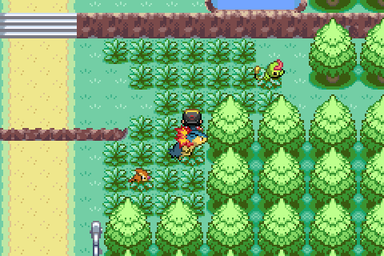
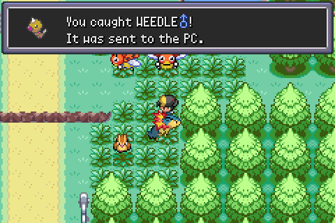
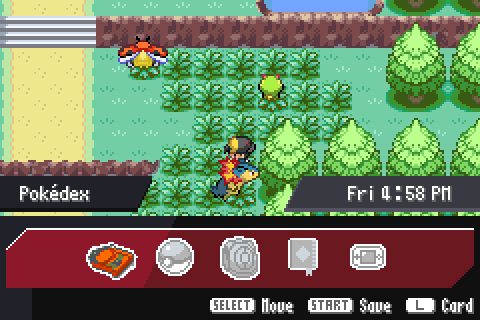
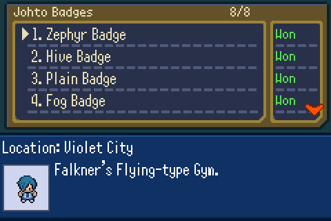
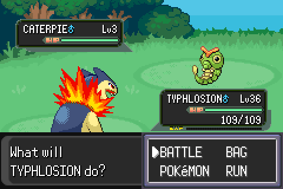
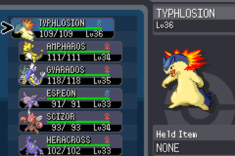
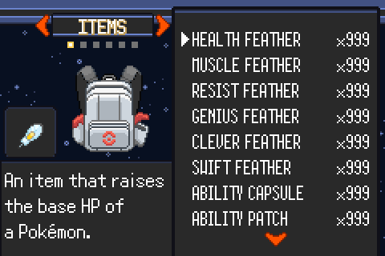
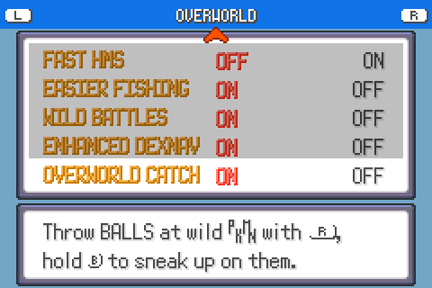

<p align="center"></p>

<p align="center">
  <b>Johto, its story and Kanto after it, on the GBA: Pokémon Heart &amp; Soul with Soulgold's best ideas and a few of its own.</b><br>
  <a href="https://github.com/Marcogn/pokehns-expansion-plus/releases/latest"><b>Download the latest patch</b></a> ·
  <a href="CHANGELOG.md">What changed</a> ·
  <a href="#options">Options</a> ·
  <a href="#credits">Credits</a>
</p>

<p align="center">
  
  
  
  <br>
  
  
  
  <br>
  
  
  
</p>

**Pokémon Heart & Soul +** is an unofficial fan game built on
[**Pokémon Heart & Soul 2.0.6**](https://github.com/PokemonHnS-Development/pokehns-expansion),
the GBA remake of Gold, Silver and Crystal and demake of HeartGold and
SoulSilver. The whole of Heart & Soul is still there: Johto, Kanto, Gen 1-3
Pokémon with their later evolutions, following Pokémon, day and night, HGSS
music, the challenge modes. On top of it, the **+** brings over features from
[**Soulgold**](https://eemeliri.github.io/soulgold/), switches on a few that
were already in the code, and adds its own: wild Pokémon you can see and catch
on the map, a quest book, two side quests and a darker interface.

Nothing of Heart & Soul was removed, and **a save from Heart & Soul 2.0.6
keeps working**: new data is only ever added at the end of the save.

---

## How to play

1. Get a clean **Pokémon Emerald (USA)** ROM. Its SHA-1 must be
   `f3ae088181bf583e55daf962a92bb46f4f1d07b7`: the patch works on that exact
   file only.
2. Download the `.bps` patch from the
   [latest release](https://github.com/Marcogn/pokehns-expansion-plus/releases/latest).
3. Apply it with a BPS patcher such as
   [Rom Patcher JS](https://www.marcrobledo.com/RomPatcher.js/) (in the
   browser) or [Flips](https://github.com/Alcaro/Flips). You get a 32 MB ROM.

**Coming from Heart & Soul?** Rename your save to match the new ROM (for
example `pokehns_plus.sav` next to `pokehns_plus.gba`). The title screen reads
**HEART & SOUL +** with the version under PRESS START, and the save window
shows it too: quote it when you report a bug.

---

## What's new

### Exploring

- **Wild Pokémon on the map.** Up to three roam the grass, two on water, in
  caves and indoors, and they stop random battles there. Each species family
  has a temperament: some wander, some watch you, some come closer, chase you,
  run away or vanish. They hear you run or cycle from 5 tiles and walk from 2,
  and see you only in front of them, never through trees or walls. Shiny ones
  sparkle. Fishing, Rock Smash, Headbutt, Sweet Scent and the DexNav work as
  before.
- **Throw Balls from the map.** **R** throws the selected Ball at the wild
  Pokémon in front of you, with a real throw: if it holds, the Pokémon is yours
  without a battle. **L** switches to sending out a Pokémon instead, **L +
  Left/Right** picks which. Catch it before it notices you and the odds
  double: with `AUTORUN` on, hold **B** to creep.
- **DexNav**, from the pause menu: in its Enhanced mode the search always finds
  a spot and the Pokémon stays put, and the list shows every species in the
  area, seen or not.
- **Overworld speed-up** up to 4x (cutscenes stay at normal speed) and
  **Fast HMs**: no prompt, no message, no pose.
- **Item descriptions**: every item you find or receive shows its icon and
  what it does at the top of the screen.
- **Pokémon Centers at night** play the Diamond and Pearl night theme.

### Battling

- **Battle speed-up** up to 3x, animations kept intact.
- **Types shown in battle**, with Soulgold's icons.
- **Shiny healthbox**: a shiny Pokémon's box is gold, or dark with a gold
  border under the dark theme.
- **Frostbite replaces freezing**, as in Legends: Arceus: no more turns lost
  to a freeze, but half damage on special moves and 1/8 HP lost every turn.
- **Legends: Arceus formulas** (optional): stats, damage and the odds of a
  Ball thrown on the map as in Arceus.
- **Level scaling** (optional): Trainers and wild Pokémon follow your team's
  level, never below what Heart & Soul gives them.
- **Battle music theme**: Johto, Kanto, FRLG, RSE, DPPt or random for wild,
  Trainer, Gym Leader and Elite Four battles.

### Menus

- **Pause menu strip**: Start opens a band of icons over the map (Pokédex,
  DexNav, Party, Bag, Quests, Options) with the day and time; **Start**
  saves, **L** opens the Trainer Card, **R** the Pokégear, **Select** moves
  an icon.
- **Quest book**: what to do next and where, for the Johto and Kanto badges
  and the side quests below, with a picture for each.
- **Dark UI**: a dark theme for battle, the bag, the summary, the party
  screen, and every message and menu outside battle.
- **Sword/Shield-style party menu**, or the classic one, and **Soulgold's bag
  screen**.
- **PC boxes**: sort a box or all of them by Pokédex number or name, and
  search for a species across every box.
- **Move relearner from the summary** (Start on the moves page), and the
  **Pokédex from the party menu**.

### Side quests

- **The TcloneR**, an original story of this fork. One of Prof. Elm's former
  assistants went over to Team Rocket and built a device that clones a
  Trainer's Pokémon in battle. Meet him five times along Team Rocket's story,
  starting in Azalea Town, and learn why he did it. With the TcloneR in the
  bag a Ball always catches a Trainer's Pokémon; every 10 clones he has a
  prize for you. <details><summary>Rules and prizes</summary>

  The Trainer does not count as beaten (no badge, no story step), stops
  noticing you until you leave the map, and has the full team back every
  battle. Facility, link and partner battles, Mirror Mode and battles that
  are part of a story scene (Silver, the Rocket admins, the hideout alarm
  grunts, the Kimono Girls, Red…) are left out; Gym Leaders, the Elite Four
  and the Champion can be cloned. Each Trainer counts once. Every 10 clones:
  20 Quick Balls, 10 Nuggets, 20 Ultra Balls, 15 Max Repels, 10 Rare Candies,
  10 Big Nuggets, then a Totodile, a Chikorita and a Cyndaquil at Lv5, and at
  100 clones a Weezing, an Arbok and a Meowth at Lv50. The six Pokémon are
  shiny and go to the PC.
  </details>
- **Red's Path.** Once you beat a Kanto Gym Leader, the guide at the entrance
  offers a VR replay of Red's journey: you play as Red, with his team of the
  time, against the Leader as he met them, in the order Red did. No running,
  no Exp., nothing to lose; each win gives that Leader's ace at Lv70.

### Items and shops

- **Candy Jar**: a Key Item that turns 90% of the Exp. from every battle into
  Exp. Candies. Elm's Aide hands it over in Violet City with the Togepi Egg.
- **Shiny Genome** (Viridian City Mart, 1000): makes a Pokémon shiny.
- **Shiny parents**: a Day-Care Egg is 4x as likely to be shiny with one shiny
  parent, 8x with two.
- **Cheaper Balls and special Balls in every Mart.** <details><summary>Prices</summary>

  Poké Ball 10, Great Ball 15, Ultra Ball 30, Quick Ball 50 (Azalea Town).
  Heal Ball 50, Nest and Repeat Ball 100 from the start; Net, Dive, Dusk,
  Timer and Luxury Ball 100 from one badge; Kurt's Love, Lure, Friend, Heavy,
  Moon, Fast and Level Ball 500 from two badges (Kurt still makes them for
  Apricorns). Ability Patch 100 and Ability Capsule 75 (Violet City), the six
  vitamins 700, the EV-lowering Berries at Goldenrod 4F, Nature Mints 100 at
  the Goldenrod flower shop (from the third badge, with the challenge menu's
  `MINTS` on). Town stock is added to the usual badge-based list, never in
  place of it.
  </details>

---

## Options

Everything new can be switched off. These are the fork's own rows; the rest of
the Options and Challenges menus is Heart & Soul's. The value in **bold** is
what a new game starts with.

| Option | Where | Values |
| --- | --- | --- |
| `DARK UI` | Options · GENERAL | **LIGHT** / DARK |
| `PARTY MENU` | Options · GENERAL | CLASSIC / **SWSH** |
| `NICKNAMES` | Options · GENERAL | **ON** / OFF |
| `OW SPEED` | Options · OVERWORLD | **1x** / 2x / 3x / 4x |
| `FAST HMS` | Options · OVERWORLD | **OFF** / ON |
| `ENHANCED DEXNAV` | Options · OVERWORLD | **ON** / OFF |
| `OVERWORLD CATCH` | Options · OVERWORLD | **ON** / OFF: off brings back R for the DexNav, the classic sight and hearing and more Pokémon on the map |
| `WILD BATTLES` | Options · OVERWORLD | **ON** / OFF: off means no wild Pokémon at all |
| `BATTLE SPEED` | Options · BATTLE | 1x / **2x** / 3x |
| `ARCEUS FORMULAS` | Options · BATTLE | **OFF** / ON |
| `BATTLE MUSIC` | Options · SOUND | **DEFAULT** / HG JOHTO / HG KANTO / FRLG / RSE / DPPT / RANDOM |
| `NIGHT CENTER` | Options · SOUND | **ON** / OFF |
| `EASY CATCH` | Challenges · DIFFICULTY | **OFF** / ON: every Ball catches |
| `LEVEL SCALING` | Challenges · DIFFICULTY | **OFF** / ON |

<details><summary>How the level scaling works</summary>

It follows your team's average level, leaving out Pokémon 7 or more levels
below your strongest. Trainers: their ace one level above that average, never
below the level Heart & Soul gives them, with plain level evolutions applied;
prize money on the real level plus 1% for every 5 levels of the level cap.
Wild Pokémon: 2-4 levels below it, never below the area's own level, never more
than 15 above it and never above the level cap. Scripted battles (the red
Gyarados, Snorlax…) at the level cap; legendaries keep their level.
</details>

<details><summary>How the Legends: Arceus formulas work</summary>

Effort levels from IVs and EVs, one catch rate for every non-legendary
species, a rank from your Johto badges, ×1.25 same-type bonus, ×2.5 and ×0.4
for double weaknesses and resistances; stat stages, abilities and items still
multiply the damage. Potions heal 60, 100 and 150 as in Arceus, and wild
Pokémon hit softer until the third Johto badge. Catches inside a battle keep
the usual formula. The full rules are in the
[changelog](CHANGELOG.md#206plus12).
</details>

---

## Bugs and feedback

Open an [issue](https://github.com/Marcogn/pokehns-expansion-plus/issues) with
the version shown on the title screen, what you did and what you expected. A
save file helps a lot. Bugs that are also in Heart & Soul 2.0.6 are worth
reporting here too: this fork fixes them where it can.

---

## For developers

```sh
make hns -j$(nproc)          # builds pokehns.gba
tools/make_patch.sh          # the BPS patch against clean Emerald
```

Setting up the toolchain: [`INSTALL.md`](INSTALL.md) (inherited from
upstream: the target of this fork is `make hns`, not `make modern`).

| Document | What it is |
| --- | --- |
| [`CHANGELOG.md`](CHANGELOG.md) | every release of the fork, with the details of each feature |
| [`docs/SOULGOLD_PORT_REPORT.md`](docs/SOULGOLD_PORT_REPORT.md) | what came over from Soulgold, where it lives, what did not and why (Italian) |
| [`docs/plans/`](docs/plans/) | the plan of each feature, with the decisions and how each phase was verified (Italian) |
| [`CLAUDE.md`](CLAUDE.md), [`.claude/rules/`](.claude/rules/) | working notes for the AI that writes the code: traps and facts by area (Italian) |
| [`FEATURES.md`](FEATURES.md), [`AVAILABLE_FEATURES.md`](AVAILABLE_FEATURES.md) | the features of Heart & Soul and of pokeemerald-expansion, from upstream |
| [`docs/HNS_README.md`](docs/HNS_README.md) | the original README of Heart & Soul |

---

## AI disclosure

This fork is written by an AI, **Claude Code** (Anthropic), **working under my
direction**. I want that stated plainly rather than buried.

- **I decide.** Which features exist, which Soulgold ones are worth bringing
  over, how each one should behave and look, what is kept off by default, what
  is left out. I read the results, play the builds, report what is wrong, and
  say what to change.
- **Claude does the work.** It reads the codebases, writes the C, scripts and
  build tooling, ports code from Soulgold, builds the ROM, and checks the
  result in an emulator. When I steer it away from a first guess, it is
  usually because something it believed turned out to be wrong, and the
  history of this repo has plenty of those corrections.
- **Neither of us is the source of the game.** The game, its art, its music
  and most of its code come from the projects credited below. Nothing here is
  generated art or music. The "+" in the logo and on the title screen is drawn
  by script.

The AI disclosure of Heart & Soul, which covers *their* code and not this
fork's, is in their [original README](docs/HNS_README.md).

---

## Credits

**This fork** is directed by [**Marcogn**](https://github.com/Marcogn) and
written by **Claude Code** (Anthropic), as described in the
[AI disclosure](#ai-disclosure). The **TcloneR** side quest is Marcogn's own:
the idea, the story, the scientist and his dialogue.

**Soulgold.** The overworld and battle speed-ups, the bag screen, the dark UI
for battle and the bag, the shiny healthbox, the Candy Jar, the Shiny Genome,
the Fast HMs, the battle-music theme and the Pokémon Center night music, the
level-scaling engine, the item description box, the art of the in-battle type
icons, the four Diamond/Pearl tracks and the search half of the Enhanced
DexNav are the work of the [Soulgold](https://eemeliri.github.io/soulgold/)
project and its author [**Eemeliri**](https://github.com/eemeliri), and of
the people Soulgold credits in turn. The bug fixes listed in the changelog as
coming from Soulgold are theirs too. The full Soulgold credits are worth
reading on their own: see the
[Soulgold repository](https://github.com/eemeliri/soulgold) and its site.

- [**Mont**](https://github.com/montmoguri/pokeemerald-expansion/) - the SwSh
  party menu, which reached this fork by way of Soulgold.

**Heart & Soul and pokeemerald-expansion.** The DexNav, the HGSS Pokédex, the
in-battle type icon code, the move relearner and the wild Pokémon on the map
(by **Bivurnum** and **HashtagMarky**, who credit Pokabbie's *Emerald Rogue*)
came with **`pokemonHnS-expansion`**, **`pokeemerald-expansion`** or both, and
are the work of their authors: this fork switched them on and finished them.
The temperament weights are modelled on
[*Wilds of Kanto*](https://github.com/YoDrehDenSwagAuf/overworld-spawn-mod)
(MIT). The game itself, Johto, the story, the art and the music are the work
of the **Pokémon Heart & Soul** team and its contributors, listed in
[`CREDITS.md`](CREDITS.md), which is inherited unchanged from upstream.

**Other projects.** The quest book screen is PokemonSanFran's
[*Unbound Quest Menu*](https://github.com/PokemonSanFran/pokeemerald/wiki/Unbound-Quest-Menu),
itself built on the Unbound quest menu, and the work of the people its
documentation credits. The pause menu strip, its band and its Pokédex,
Party, Bag and Options icons are
[**pollythadon**](https://github.com/pollythadon/pokeemerald-expansion)'s
Unbound-style start menu. Both were ported by hand and rewritten where this
fork needed it (save data, state sources, one page, Flash, dark theme).

**The chain below** applies to this fork unchanged: **`pokemonHnS-expansion`**,
RHH's **`pokeemerald-expansion`**, resetes12's **`Modern Emerald`** and pret's
**`pokeemerald`** decompilation. If you use this fork, credit **Pokémon Heart &
Soul** and keep that chain, as the [original README](docs/HNS_README.md) asks.

*Pokémon is a trademark of Nintendo, Game Freak and Creatures Inc. This is an
unofficial fan project and is not affiliated with or endorsed by them. It
distributes only a patch: you need your own clean Pokémon Emerald ROM.*
